# Performance Harness: Overview

A repeatable way to go from client documents to a tested k6 load run and a client pack. Copilot drafts the work in VS Code. Python tools check it, run it and report it against fixed rules. Setup, ground rules and troubleshooting are in the [README](../README.md).

## How it works

- **Instructions** ([.github/copilot-instructions.md](../.github/copilot-instructions.md)): the rules Copilot always follows.
- **Prompts** ([.github/prompts/](../.github/prompts)): the slash commands. They are thin; the detail lives in the skills.
- **Skills** ([.github/skills/](../.github/skills)): one guide per stage. [end-to-end](../.github/skills/end-to-end/SKILL.md) loops on `tools/next.py` and calls the others.
- **Agents** ([.github/agents/](../.github/agents)): optional. `perf-orchestrator` hands each stage to `perf-intake`, `perf-discovery`, `perf-scripter` or `perf-runner`. The runner has no edit tool, so it cannot change run files, reports or the pack.
- **Tools** ([tools/](../tools)): deterministic Python. `status.py` is the source of truth for which stage is done; `next.py` turns it into one next action and the human gates; `doctor.py` checks the machine.
- **Projects** (`projects/<client>/<app>/`): one folder per client application with its sources, BRD, environments, catalogue, script, runs and pack.

## Stages

| # | Stage | Prompt or skill | Tool |
|---|---|---|---|
| 1 | BRD (intake, gap questions, Word file for the client) | `requirements-intake`, `brd-builder` | `brd.py`, `brdexport.py` |
| 2 | Environment and authorisation | you fill `environments.yaml` | `envconf.py` |
| 3 | API catalogue | `/build-catalogue`, `api-source-selector` and the catalogue skills | `catalogue.py` |
| 4 | Target check (read-only) | `end-to-end` | `targetcheck.py` |
| 5 | k6 script | `/build-script` | `k6check.py` |
| 6 | Smoke run | `/run-test` | `runk6.py` |
| 7 | Load runs and monitoring | `/run-test`, `monitoring-evidence` | `runk6.py`, `monitor.py` |
| 8 | Report | `/build-report` | `report.py` |
| 9 | Client pack | `/build-pack` | `clientpack.py` |

Start with `/check-setup` once, then `/run-end-to-end` (or `/start-project` for a new project).

## Flow chart: stages and the files each one touches

```mermaid
flowchart TD
    classDef stage fill:#dbeafe,stroke:#1d4ed8,color:#000
    classDef gate fill:#fee2e2,stroke:#b91c1c,color:#000
    classDef file fill:#f3f4f6,stroke:#6b7280,color:#000
    classDef out fill:#dcfce7,stroke:#15803d,color:#000

    START(["Run: python tools/next.py PROJECT"]) --> S1

    subgraph ST1["Stage 1 - BRD"]
        direction TB
        F1a[("sources/ - client files")]:::file
        F1b[("templates/brd.template.yaml")]:::file
        S1["requirements-intake, brd-builder<br/>tools: brd.py, brdexport.py"]:::stage
        G1{{"GATES: sources, business_facts"}}:::gate
        O1[("brd.yaml, brd.md, open-items.md, STATE.md")]:::out
        O1b[("client-pack/brd-confirmation-vN.docx")]:::out
        F1a --> S1
        F1b --> S1
        S1 --- G1
        S1 --> O1
        S1 --> O1b
    end

    ST1 --> S2

    subgraph ST2["Stage 2 - Environment"]
        direction TB
        F2a[("templates/environments.template.yaml")]:::file
        S2["Fill URL, owner, limits, monitoring<br/>tool: envconf.py check, show, use"]:::stage
        G2{{"GATES: environment, authorisation"}}:::gate
        O2[("environments.yaml")]:::out
        F2a --> S2
        S2 --- G2
        S2 --> O2
    end

    ST2 --> S3

    subgraph ST3["Stage 3 - API catalogue"]
        direction TB
        F3a[("sources/ - Postman, OpenAPI, HAR or API list")]:::file
        F3b[("brd.yaml - transaction ids")]:::file
        F3c[("templates/api-catalogue.template.yaml")]:::file
        S3["api-source-selector, then catalogue or discovery skill<br/>tool: catalogue.py import, check"]:::stage
        O3[("api-catalogue.yaml")]:::out
        F3a --> S3
        F3b --> S3
        F3c --> S3
        S3 --> O3
    end

    ST3 --> S4

    subgraph ST4["Stage 4 - Target check (read-only)"]
        direction TB
        F4a[("api-catalogue.yaml")]:::file
        F4b[("environments.yaml - base_url, credentials_env_vars names")]:::file
        S4["tool: targetcheck.py<br/>one request per read API"]:::stage
        G4{{"GATES: authorisation, credentials"}}:::gate
        O4[("target-check.json; environments.yaml verified note")]:::out
        F4a --> S4
        F4b --> S4
        S4 --- G4
        S4 --> O4
    end

    ST4 --> S5

    subgraph ST5["Stage 5 - k6 script (never run here)"]
        direction TB
        F5a[("brd.yaml")]:::file
        F5b[("api-catalogue.yaml")]:::file
        F5c[("skills/k6-script-builder/reference-skeleton.js")]:::file
        S5["k6-script-builder skill, perf-scripter agent<br/>tool: k6check.py"]:::stage
        O5[("k6/script.js, k6/requirement-map.yaml")]:::out
        F5a --> S5
        F5b --> S5
        F5c --> S5
        S5 --> O5
    end

    ST5 --> S6

    subgraph ST6["Stage 6 - Smoke run (1 user)"]
        direction TB
        F6a[("k6/script.js")]:::file
        F6b[("environments.yaml - base_url, max_vus, authorisation")]:::file
        S6["tool: runk6.py --profile smoke"]:::stage
        G6{{"GATES: authorisation, failed_run"}}:::gate
        O6[("runs/RUN-ID/ - run.json, summary.json, k6-output.txt, report.html")]:::out
        F6a --> S6
        F6b --> S6
        S6 --- G6
        S6 --> O6
    end

    ST6 --> S7

    subgraph ST7["Stage 7 - Load runs and monitoring"]
        direction TB
        F7a[("environments.yaml - run_plan, monitoring")]:::file
        F7b[("k6/script.js")]:::file
        S7["tool: runk6.py --profile load, steps up to the peak<br/>monitor.py samples CPU and memory"]:::stage
        G7{{"GATES: run_plan, failed_run, targets_missed"}}:::gate
        O7[("runs/RUN-ID/ - run.json, summary.json, k6-output.txt, monitoring.json, dashboard.html")]:::out
        F7a --> S7
        F7b --> S7
        S7 --- G7
        S7 --> O7
    end

    ST7 --> S8

    subgraph ST8["Stage 8 - Report"]
        direction TB
        F8a[("runs/RUN-ID/ - run.json, summary.json, monitoring.json")]:::file
        F8b[("brd.yaml, k6/requirement-map.yaml, environments.yaml")]:::file
        S8["tool: report.py<br/>automatic after every run"]:::stage
        O8[("runs/RUN-ID/report.html")]:::out
        F8a --> S8
        F8b --> S8
        S8 --> O8
    end

    ST8 --> S9

    subgraph ST9["Stage 9 - Client pack (never sent)"]
        direction TB
        F9a[("brd.yaml and every runs/RUN-ID/ folder")]:::file
        S9["tool: clientpack.py<br/>refuses on secret-like text"]:::stage
        O9[("client-pack/APP-RUN-ID/ - index.html, brd.html, runs/, manifest.json, plus .zip")]:::out
        F9a --> S9
        S9 --> O9
    end

    ST9 --> DONE(["ALL STAGES DONE - read the cover before sharing"])
```

Grey = files read, green = files written, red = human gates (`tools/next.py` stops there), blue = the stage. Paths are inside `projects/<client>/<app>/` unless they start with `templates/` or `skills/` (repo level). `STATE.md` is updated at the end of every stage.

## Rules that always apply

- No invented values. Anything not in a source or in your answer stays empty and is asked about.
- No real personal or payment data, and no passwords or tokens in any file.
- Discovery is read-only. No load is sent until the test is approved and the environment is authorised.
- Stated, assumed and open items are kept separate.
- Nothing is sent to the client or anyone else by the harness.

## Example projects

`projects/_example/` is the only project tracked in git (a neutral fixture for a first dry run with `python tools/brd.py check projects/_example/brd.yaml`). Real client projects live under `projects/` locally but are git-ignored; `python tools/status.py <project>` shows the current stage of any of them.
